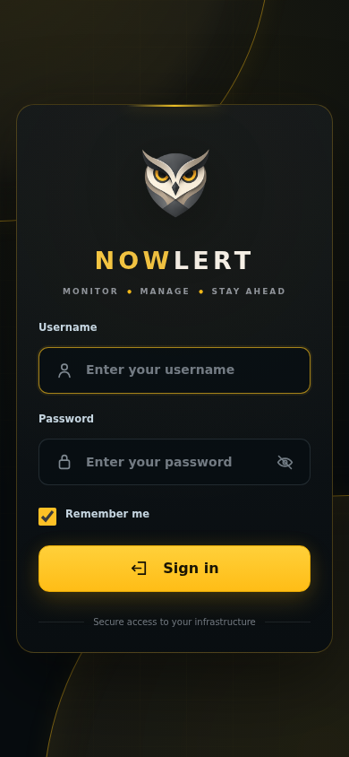

<p align="center">
  
</p>

<h1 align="center">Nowlert CE</h1>

<p align="center">
  <strong>Infrastructure reports. Nowlert delivers.</strong><br>
  Community Edition · free & open source · self-hosted
</p>

<p align="center">
  <a href="https://github.com/Theriark/nowlert-ce/releases"></a>
  <a href="https://github.com/Theriark/nowlert-ce/releases"></a>
  <a href="https://www.python.org/"></a>
  
  
</p>

**Self-hosted infrastructure notifications from SMTP, HTTP, Redfish, and Email Alerts to Teams, Slack, Discord, Email, Nowlert Mobile, and webhooks.**

Nowlert CE is the free, open-source, self-hosted edition of Nowlert. It receives
infrastructure signals, normalizes vendor-specific events, applies deterministic
routing, and delivers clear operational notifications through the tools and
workflows teams already use.

**Receive → Normalise → Route → Deliver**

**MIT · Docker-ready · Local SQLite · Same-origin WebUI**

[Quick Start](#-quick-start) · [Supported integrations](#-supported-integrations) · [Documentation](docs/README.md) · [Releases](https://github.com/Theriark/nowlert-ce/releases)

---

# 🚀 Quick Start

## 1. Clone and prepare configuration

```bash
git clone https://github.com/Theriark/nowlert-ce.git
cd nowlert-ce

cp .env.example .env
cp config/config.example.yaml config/config.yaml
mkdir -p logs/emails secrets state external-backups
chmod 600 .env config/config.yaml
chmod 700 logs logs/emails secrets state external-backups
```

Set `NOWLERT_UID` and `NOWLERT_GID` in `.env` to the numeric user/group that
owns the mounted directories:

```bash
id -u
id -g
```

## 2. Validate and start

```bash
docker compose -f compose.production.yaml config
docker compose -f compose.production.yaml pull
docker compose -f compose.production.yaml up -d
docker compose -f compose.production.yaml ps
docker logs -f nowlert-ce
```

The default production image is:

```text
theriark/nowlert-ce:3.1.6
```

## 3. Create the first administrator

On an empty platform database, the container log prints a short-lived,
single-use setup token. Open the WebUI and use that token to choose the first
administrator username and password.

There is no default password.

## Optional: Gmail and Microsoft 365 mailbox login

Nowlert CE does not contain a Theriark-owned OAuth secret. Each self-hosted
operator registers its own Google and/or Microsoft OAuth application for its
Nowlert URL. Put the public client ID in `.env` and mount the client secret
under `/run/secrets`; mailbox users then only see **Continue to Google** or
**Continue to Microsoft**.

See [Container deployment and release flow](docs/deployment.md#email-alerts-oauth-applications)
for the exact secret filenames and redirect URI requirements.

---

# 🚀 Project Status

| Property | Value |
|---|---|
| **Status** | v3.1.6 stable · v27.0.0 in release-candidate testing |
| **Current Stable Release** | **v3.1.6** |
| **Development line** | v27.0.0 release candidates (`v27.0.0-rc.N` pre-release tags); not a stable release |
| **Version reported by development builds** | 3.1.6 (the version number changes only when v27.0.0 is released) |
| **License** | MIT |
| **Python** | 3.13 |
| **Current development database schema** | 18 |
| **Configuration model** | `platform_database_v1` |
| **State path** | `/nowlert/state` |

## What changed in v3.1.6

v3.1.6 was a release-automation maintenance patch. Its release notes describe
that published snapshot; development changes are not stable-release claims.

Current development uses database schema **18** with `platform_database_v1`.
See the [current configuration contract](docs/current-configuration-model.md)
for migration and backup guidance before upgrading.

Highlights:

- keeps Stage as the final live runtime acceptance gate;
- keeps the release chain Development → Stage → main → Release;
- moves the Development image build, immutable-image verification, and
  Development deployment directly into Continuous Integration after a green
  `development` push;
- moves stable GHCR/Docker Hub alias publication into Finalize CE Release;
- reduces the active workflow set to Continuous Integration, Promote CE to
  Stage, and Finalize CE Release; and
- preserves the build-once immutable image model with no rebuild during
  promotion or release publication.

See [v3.1.6 release notes](docs/releases/v3.1.6.md) and the
[v3.1.6 QA checklist](docs/releases/validation/v3.1.6-qa-checklist.md).

---

# 📸 Preview

The current WebUI of the v27.0.0 release-candidate line, captured on 21 October
2026 from the Development deployment of the `development` branch with
synthetic test data. These are part of the reviewed screenshot set of the
`v27.0.0-rc.7` documentation package; the Development build `66d50b00` runs
the same application source (`9823244c`); its Dashboard, Routing Flow and
Destinations pages were compared live with these captures on 24 October 2026.

| Sign in | Dashboard | Routing Flow |
|---|---|---|
|  |  |  |

The Preview shows only captures in which no account name, owner label,
destination or channel name of the Development test data is visible. The
desktop captures of the same set show those synthetic names, so they appear
only in the [WebUI guide](docs/webui.md) and the
[capture index](docs/images/v27.0.0-rc.1/README.md); whether they belong on
this front page is an open point of the
[screenshot privacy review](docs/guides/screenshot-privacy.md#open-points-for-a-person).

Older captures of earlier interfaces (v3.1.0 and v2.5.2) are kept only as
history; the [documentation index](docs/README.md#historical-screenshots)
lists them, and the screenshot privacy review records every image and the
captures that were withdrawn.

The [WebUI guide](docs/webui.md) describes every page; it shows captures of
all pages except those left out for privacy.

---

# What is Nowlert?

**Nowlert is an infrastructure operations platform that transforms system
signals into clear, structured operational information and delivers it through
the tools and workflows teams already use.**

In Community Edition, that foundation is parser-driven and self-hosted. It
accepts events from infrastructure products, converts them into one shared
notification model, applies deterministic routes, and renders destination-aware
notifications. The goal is not to replace monitoring, storage, virtualization,
networking, backup, or hardware-management systems. The goal is to make the
events they already emit easier to route, read, and act on.

Nowlert can ingest Email Alerts through configured mailbox connections as well
as direct SMTP delivery. SMTP-capable systems can send mail directly to Nowlert;
webhook-capable systems post to authenticated HTTP endpoints; supported hardware
controllers can submit Redfish Event Service notifications.

---

# 🦉 Why the name?

**Nowlert** combines **now**, an observant **owl**, and an actionable **alert**.
The name reflects the product's purpose: receive infrastructure events,
identify what matters, and deliver a clear notification while it is still
useful.

Immediate. Readable. Actionable.

---

# Why Nowlert?

Infrastructure products still report important events through a mixture of
long HTML email, vendor-specific webhooks, and hardware event envelopes.
Nowlert gives those events a consistent operational path.

| Raw infrastructure delivery | Nowlert |
|---|---|
| Vendor-specific email or JSON | Normalized event model |
| Important fields buried in payloads | Structured source-aware presentation |
| Separate SMTP/HTTP/hardware workflows | One routing model |
| Repeated formatting per destination | Shared parser and destination adapters |
| Credentials mixed into application config | Write-only owner-scoped secrets |
| Ad-hoc forwarding rules | Deterministic priority and fallback routing |
| Hard-to-audit changes | Local users, audit log, delivery history |

---

# ✨ Features

## Event ingestion

- native SMTP listener;
- authenticated HTTP Event API;
- dedicated vendor HTTP webhook endpoints;
- Redfish Event Service ingestion;
- Email Alerts from connected mailboxes (not in the `3.1.6` image);
- optional SMTP STARTTLS and SMTP AUTH;
- bounded request and payload handling;
- parser-based source detection and normalization.

## Routing

- database-authoritative routes;
- integration + input route identity;
- numeric priority with deterministic tie-breaking;
- host and event include/exclude patterns;
- included severity and status selection;
- fallback-only wildcard routes;
- duplicate-delivery suppression per destination;
- enable/disable controls without rewriting `config.yaml`.

### Dedicated integration routes

Nowlert evaluates enabled routes for the detected integration first. A wildcard
route is a true fallback, not an additional fan-out rule.

### Fallback routes run only when needed

Fallback routes run only when no enabled dedicated route matches the event.
This prevents a specific iDRAC, Zabbix, or other source event from also being
sent through a generic fallback destination unless that is the only matching
path.

## Destinations

Current development and the v27.0.0 release candidates support:

- Discord;
- Microsoft Teams;
- Slack;
- Email over SMTP;
- Nowlert Mobile; and
- generic webhooks.

The stable `3.1.6` image delivers to Discord, Microsoft Teams, Slack, generic
webhooks, MQTT, and ntfy. Email and Nowlert Mobile destinations were added after
v3.1.6; MQTT and ntfy are no longer offered.

Destination credentials are write-only. Read APIs expose only safe metadata
such as whether a secret is configured. Private destinations are owner-scoped;
administrators may explicitly share destinations for route use.

## Rich presentation

- source-aware Discord components;
- Microsoft Teams Adaptive Cards;
- severity/status styling;
- structured event, host/device, source, and time fields;
- packaged source artwork;
- explicit preview and test-delivery flows;
- bounded Microsoft Teams payload size with accurate accepted/delivered wording.

## WebUI

The bundled same-origin WebUI provides:

- Dashboard/Overview analytics and routing flow;
- Destinations with built-in route assignments;
- Filtering;
- Profile menu → Security → API tokens;
- Delivery History;
- Audit Log;
- Users;
- Backups and Data tools;
- integration settings;
- regional preferences; and
- operational health/restart controls.

No default account exists. First startup creates a short-lived, single-use
setup token so the operator chooses the first administrator credentials.

## Platform state and backups

- SQLite with transactional schema migrations;
- `/nowlert/state` persistent mount;
- owner-only secret files;
- verified private state snapshots;
- explicit restore safety snapshot;
- individual backup deletion;
- Local, NFS, and SMB backup targets;
- scheduled backup execution;
- credential-free portability export/import.

## Security

- non-root production container;
- read-only root filesystem;
- dropped Linux capabilities;
- `no-new-privileges`;
- HttpOnly SameSite session cookies;
- optional Secure cookie mode;
- CSRF protection on unsafe session requests;
- source-scoped Event API tokens stored as hashes;
- write-only destination credentials;
- no credential values in audit or delivery history.

---

# 🔌 Supported Integrations

Integrations are packaged with the image. Inputs are the normalized transport
used to receive the event. The table lists the 22 integrations of current
development and the v27.0.0 release candidates; the generic Email Alerts source
is described under [Email Alerts](docs/integrations/README.md#email-alerts).

The stable `3.1.6` image includes 15 of them. Prometheus, Checkmk, Semaphore,
Sonarr, Radarr, Metabase, and GitHub Actions were added after v3.1.6 and are
not in the `3.1.6` image.

| Integration | Source key | Inputs | Default category |
|---|---|---|---|
| Xen Orchestra | `xo` | SMTP | Virtualization |
| Zabbix | `zabbix` | SMTP, HTTP | Monitoring |
| Grafana | `grafana` | HTTP | Monitoring |
| Prometheus | `prometheus` | HTTP | Monitoring |
| Checkmk | `checkmk` | HTTP | Monitoring |
| Portainer | `portainer` | HTTP | Containers |
| Semaphore | `semaphore` | SMTP, HTTP | Automation |
| Sonarr | `sonarr` | HTTP | Automation |
| Radarr | `radarr` | HTTP | Automation |
| Metabase | `metabase` | HTTP | Monitoring |
| GitHub Actions | `github_actions` | HTTP | Automation |
| Proxmox | `proxmox` | HTTP | Virtualization |
| QNAP | `qnap` | SMTP | Storage |
| Synology | `synology` | SMTP, HTTP | Storage |
| TrueNAS | `truenas` | SMTP | Storage |
| UniFi Network | `unifi_network` | HTTP | Networking |
| UniFi Protect | `unifi_protect` | HTTP | Security |
| UniFi Drive | `unifi_drive` | HTTP | Storage |
| Supermicro | `supermicro` | Redfish | Hardware |
| HPE iLO | `hpe_ilo` | Redfish | Hardware |
| Dell iDRAC | `dell_idrac` | Redfish | Hardware |
| Home Assistant | `home_assistant` | HTTP | Automation |

Detailed setup guides are under [`docs/integrations/`](docs/integrations/);
Checkmk is described in [Checkmk notifications](docs/checkmk.md).

---

# 🎯 Project Goals

Nowlert is designed to:

1. normalize infrastructure events without replacing the systems that emit
   them;
2. keep routing deterministic and explainable;
3. keep credentials out of public configuration and read APIs;
4. remain practical for a single-node homelab while using production-quality
   security boundaries;
5. make deployment state, source commit, and released image traceable; and
6. keep documentation, tests, release metadata, and screenshots aligned with
   the shipped image.

---

# 🧩 Core Concepts

## Integration

A built-in source family such as Xen Orchestra, Zabbix, or Dell iDRAC.

## Input

The normalized transport: **SMTP**, **HTTP**, **Redfish**, or **Email Alerts**
(mailbox connections; not in the `3.1.6` image).

## Normalized event

The shared internal representation produced after source detection and parsing.
It carries the event identity, source, title/message, severity/status, and
bounded metadata used by routing and presentation.

## Route

A database record that connects an integration/input contract to a destination.
Routes may constrain hosts, events, severities, and statuses.

## Destination

A configured output target such as Discord or Microsoft Teams. Public settings
and secret credentials are separated.

## Fallback route

A wildcard route evaluated only when no dedicated integration route matches.

## Event API token

A source-scoped token accepted only by `POST /api/v2/events`. It is not a WebUI
login credential and cannot manage platform resources.

---

# 🏗️ Architecture

```text
Infrastructure product
        |
        | SMTP / HTTP / Redfish / Email Alerts mailbox
        v
+-----------------------------+
| Input adapters              |
+-----------------------------+
        |
        v
+-----------------------------+
| Source detection + parsers  |
+-----------------------------+
        |
        v
+-----------------------------+
| Normalized event model      |
+-----------------------------+
        |
        v
+-----------------------------+
| Database-backed routing     |
| dedicated -> fallback       |
+-----------------------------+
        |
        v
+-----------------------------+
| Destination adapters        |
| Discord / Teams / Slack /   |
| Email / Mobile / Webhook    |
+-----------------------------+
        |
        v
 Collaboration / automation
```

The management plane uses the same local platform state:

```text
WebUI <-> /api/v2 <-> SQLite + owner-scoped secret files
                    |
                    +-> audit history
                    +-> delivery history
                    +-> backups
                    +-> settings
```

---

# ⚡ Design Principles

## Build once, promote the same image

A Development build produces an immutable GHCR digest. Stage deploys that exact
digest without rebuild and is the final live runtime acceptance gate. Release
finalization and stable registry publication reuse the same approved digest;
they do not rebuild from a branch or release tag.

## Branches represent approved source state

- `development` is cumulative active work;
- `stage` is the source commit approved by the Stage promotion gate; and
- `main` is fast-forwarded to that same Stage-approved commit before release
  finalization.

## Configuration is split by responsibility

`config.yaml` contains process/bootstrap settings. WebUI-managed resources are
stored in SQLite under `/nowlert/state`.

## Secrets are write-only

Destination credentials and other sensitive values are not returned by normal
read APIs, history, or audit views.

## Failure is scoped

One damaged destination, route, or settings record should not make unrelated
resources or pages unavailable.

---

# ⚙️ Configuration

The public configuration uses:

```yaml
http:
  enabled: true
  host: 0.0.0.0
  port: 8080

api:
  enabled: true

platform:
  enabled: true
  state_dir: /nowlert/state
  configuration_model: platform_database_v1
  secure_cookies: false

webui:
  enabled: true
  public_url: ""
  enforce_https: false
```

`config.yaml` is intentionally limited to process bootstrap, listeners,
transport security, state location, and WebUI publication settings.

Do **not** recreate legacy WebUI-managed YAML sections such as `outputs`,
`routing`, `api.tokens`, `notifications`, `presentation`, `home_assistant`,
`redfish`, `platform.backups`, or `webui.language` in a fresh configuration,
whether for the v3.1.6 release or a current development build.

See [Current configuration model](docs/current-configuration-model.md).

---

# 📬 SMTP Configuration

SMTP can be used directly by products such as Xen Orchestra, QNAP, and TrueNAS.
STARTTLS and SMTP AUTH are optional and disabled by default.

For an untrusted network, enable TLS before enabling SMTP AUTH. Store passwords
in environment variables or mounted secrets rather than tracked files.

See [SMTP security](docs/smtp-security.md).

---

# 🔄 Example Flow

A Zabbix webhook arrives over HTTP:

```text
Zabbix
  -> HTTP input
  -> Zabbix parser
  -> normalized event
  -> enabled Zabbix HTTP routes
  -> host/event/severity/status filters
  -> selected destination
  -> Discord / Teams / Slack / Email / webhook
```

If no dedicated Zabbix route matches, Nowlert may then evaluate an enabled
Fallback HTTP route.

The same routing model is used for SMTP and Redfish events.

---

# 🛡️ Production Deployment

The supplied production Compose definition:

- runs as the configured numeric UID/GID;
- drops capabilities;
- prevents privilege escalation;
- uses a read-only root filesystem;
- provides bounded temporary storage; and
- persists only the configured state, logs, configuration, and backup mounts.

Recommended persistent paths:

| Container path | Purpose |
|---|---|
| `/nowlert/config` | bootstrap configuration and optional certificate material |
| `/nowlert/state` | SQLite database, owner-scoped secrets, private state backups |
| `/nowlert/logs` | application logs and optional retained event material |
| `/run/secrets` | externally managed read-only secrets |
| `/nowlert/external-backups` | bounded external backup target |

Back up `config`, `state`, and external `secrets` as one matched set before an
upgrade or rollback.

See [Deployment](docs/deployment.md) and
[Platform state](docs/platform-state.md).

---

# 🔐 Browser and API Security

Use direct HTTP only on a trusted private network. Internet-facing or otherwise
untrusted access should terminate TLS at a trusted reverse proxy and enable:

```yaml
platform:
  secure_cookies: true

webui:
  public_url: "https://nowlert.example.com"
  enforce_https: true
```

Do not cache `/api/v2` responses and do not expose secret-bearing environment
or mount contents through the proxy.

See [Platform API](docs/platform-api.md).

---

# 💾 Backup, Restore, and Portability

There are two different safety mechanisms:

1. **Private state backup** — SQLite + owner-scoped secret files + integrity
   manifest. Use for recovery and rollback.
2. **Portable JSON export** — credential-free resource metadata. Use for
   migration and configuration transfer, not disaster recovery.

Administrators can create, verify, restore, and delete private state snapshots.
A restore creates a safety snapshot first and revokes browser sessions after a
successful swap.

See [Data portability and migration](docs/data-portability.md).

---

# 🚢 Release and Promotion Model

The CE release chain is intentionally immutable:

```text
development
   |
   | Continuous Integration
   v
Development exact digest
   |
   | Promote CE to Stage (no rebuild)
   v
stage branch == approved source SHA
   |
   | fast-forward main to stage SHA
   v
main == stage == approved source SHA
   |
   | release/finalization gates
   v
version tag + stable aliases for the same digest
```

The promotion and release workflows reject a source SHA that does not match the
expected environment branch or desired-state ledger. Stable registry aliases
are created from the already-approved immutable image; they do not rebuild the
application from the release tag.

Operational workflow details are in [Deployment](docs/deployment.md).

---

# 🗺️ Roadmap

Current priorities are intentionally conservative:

- keep the stable image, documentation, screenshots, and examples synchronized;
- broaden real-system compatibility validation;
- preserve schema migration and rollback coverage;
- keep the production container non-root and capability-minimal;
- expand integrations and destinations only behind explicit contracts/tests;
- improve drift detection and release evidence.

See the full [roadmap](docs/roadmap.md).

---

# 📚 Documentation

Start with the [documentation index](docs/README.md).

Core guides:

- [Current configuration model](docs/current-configuration-model.md)
- [Deployment](docs/deployment.md)
- [WebUI](docs/webui.md)
- [Integrations and inputs](docs/integrations-and-inputs.md)
- [Platform routing and delivery](docs/platform-routing.md)
- [Platform outputs](docs/platform-outputs.md)
- [Platform API](docs/platform-api.md)
- [Platform state](docs/platform-state.md)
- [Data portability and migration](docs/data-portability.md)
- [SMTP security](docs/smtp-security.md)
- [Presentation contract](docs/presentation-contract.md)
- [Roadmap](docs/roadmap.md)

Historical release notes and acceptance checklists remain under `docs/releases/`
and `docs/*-acceptance-checklist.md`. They describe the versions they were
written for and are intentionally not rewritten as current guidance.

---

# 🤝 Contributing

Contributions should keep behavior, tests, and documentation aligned.

Before opening a pull request:

```bash
python -m pip install -r requirements-dev.txt
python -m pytest -q
python tools/validate_current_documentation.py
```

For user-visible changes, update the relevant current guide and add or refresh
screenshots when the UI actually changed. Never use screenshots containing
credentials, token values, private URLs, or personal data.

See [CONTRIBUTING.md](CONTRIBUTING.md).

---

# 📄 License

Nowlert CE is released under the MIT License. See [LICENSE](LICENSE).

Powered by **Theriark**.
