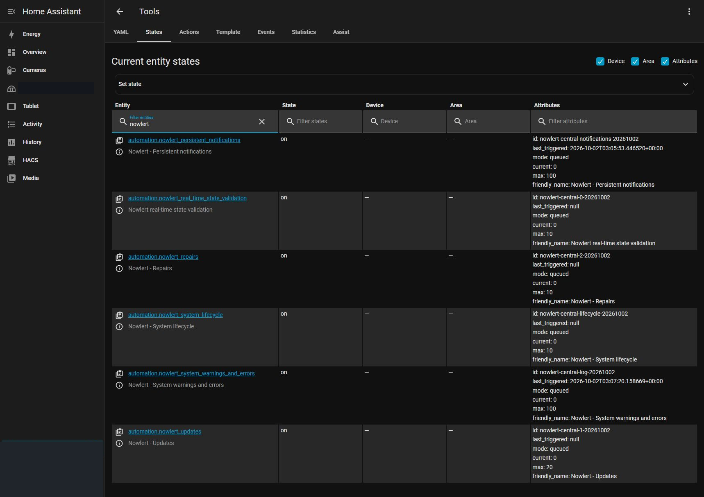
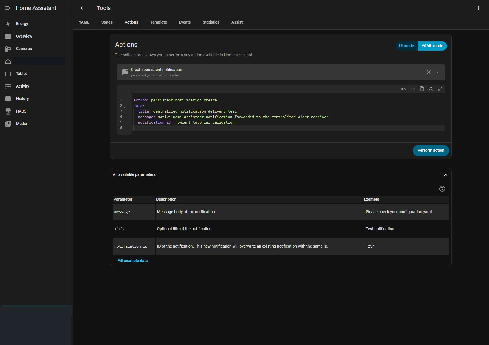
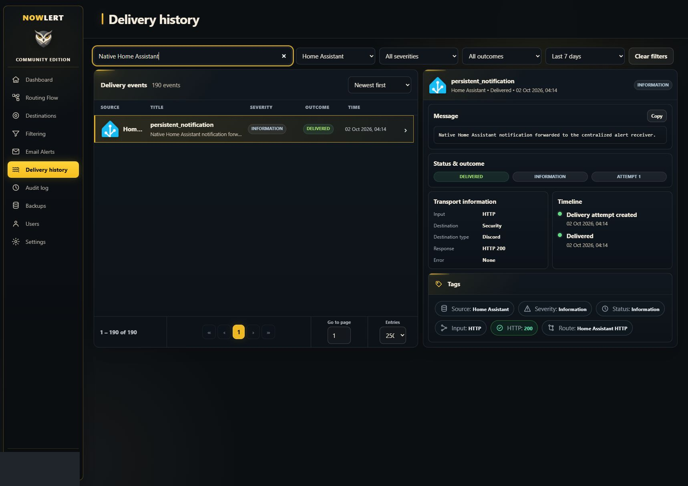
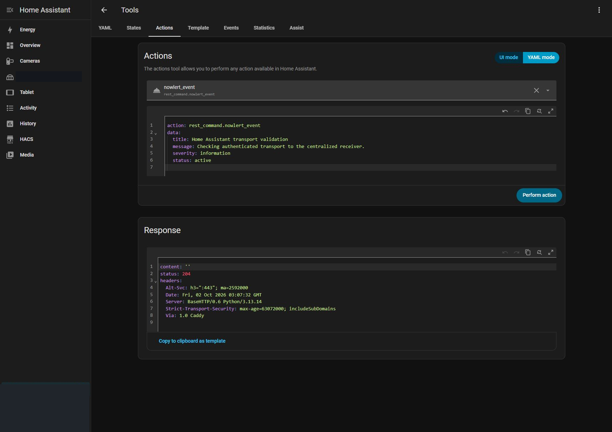

# Home Assistant alerts to Nowlert and Discord

This walkthrough was configured and tested on 2 October 2026. Home Assistant
sent a native persistent notification and real integration errors to Nowlert;
Delivery history shows the **Home Assistant HTTP** route, **Security** destination,
and Discord **HTTP 200**. Replace local names and addresses with your deployment.

## 1. Assign the built-in route

In Nowlert **Destinations**, edit your destination, open **Manage routes**, select
**Home Assistant HTTP**, then save. The demonstrated destination is Security.
Routing lives in the WebUI database; do not recreate old output/routing YAML.

## 2. Issue a scoped token

In the Nowlert **Profile menu → Security → API tokens**, create an application token allowing only
**Home Assistant**, with 120 events/minute. Copy its one-time value privately.
Do not use an administrator token or put the token in the URL.

Add to Home Assistant's `secrets.yaml`:

```yaml
nowlert_home_assistant_token: "YOUR_HOME_ASSISTANT_TOKEN"
```

Add the reusable `rest_command.nowlert_event` from the
[Home Assistant integration reference](../home-assistant.md) to
`configuration.yaml`. Set its URL to
`https://YOUR_NOWLERT_HOST/home-assistant/events`. Keep `X-Nowlert-Token` as a
`!secret` reference. Merge into existing `rest_command` and `system_log` sections;
do not create duplicate top-level keys or overwrite existing commands.

```yaml
system_log:
  fire_event: true
```

## 3. Forward the supported alert streams

Append the five ready-to-use automations below to `automations.yaml`. Preserve
existing automations. They forward:

| Stream | Coverage |
|---|---|
| System log | Warning and error events, excluding transport errors to prevent recursion |
| Updates | Available/completed transitions for every `update.*` entity |
| Repairs | Issue creation/removal events |
| Persistent notifications | Added, updated, removed, and current notifications |
| Lifecycle | Home Assistant startup and shutdown |

The tested installation also has a sixth automation for its existing validation
helper. That deployment-specific helper is not required by these automations.

```yaml
# Append these entries to automations.yaml; preserve existing automations.
# Requires rest_command.nowlert_event and system_log.fire_event: true.
- id: nowlert-central-1
  alias: Nowlert - Updates
  description: Reports newly available and completed Home Assistant updates
  triggers:
  - trigger: event
    event_type: state_changed
  conditions:
  - condition: template
    value_template: "   {{\n  entity.startswith('update.')\n\
      \  and old is not none\n  and new is not none\n  and (\n    (old.state == 'off' and new.state ==\
      \ 'on')\n    or\n    (old.state == 'on' and new.state == 'off')\n  )\n}}"
  actions:
  - variables:
      update_entity: '{{ trigger.event.data.entity_id }}'
      new_state: '{{ trigger.event.data.to_state.state }}'
      update_name: "{{\n  trigger.event.data.to_state.attributes.friendly_name\n  | default(trigger.event.data.entity_id,\
        \ true)\n}}"
      installed_version: "{{\n  trigger.event.data.to_state.attributes.installed_version\n  | default('unknown',\
        \ true)\n}}"
      latest_version: "{{\n  trigger.event.data.to_state.attributes.latest_version\n  | default('unknown',\
        \ true)\n}}"
  - action: rest_command.nowlert_event
    data:
      event_type: update
      component: update
      title: "{{\n  'Update available'\n  if new_state == 'on'\n  else 'Update completed'\n}}"
      message: '{{ update_name }}. Installed version: {{ installed_version }}. Latest version: {{ latest_version
        }}.'
      severity: '{{ ''information'' if new_state == ''on'' else ''success'' }}'
      status: '{{ ''active'' if new_state == ''on'' else ''resolved'' }}'
      category: update
      entity_id: '{{ update_entity }}'
      device: '{{ update_name }}'
      area: ''
      tags:
      - home-assistant
      - update
  mode: queued
  max: 20
- id: nowlert-central-2
  alias: Nowlert - Repairs
  description: Reports new and cleared Home Assistant repair issues
  triggers:
  - trigger: event
    event_type: repairs_issue_registry_updated
  conditions:
  - condition: template
    value_template: "{{\n  trigger.event.data.action\n  | default('', true)\n  in ['create', 'remove']\n\
      }}"
  actions:
  - variables:
      repair_action: '{{ trigger.event.data.action | default(''unknown'', true) }}'
      repair_domain: '{{ trigger.event.data.domain | default('''', true) }}'
      repair_id: '{{ trigger.event.data.issue_id | default(''unknown'', true) }}'
  - action: rest_command.nowlert_event
    data:
      event_type: repair
      component: '{{ repair_domain }}'
      title: "{{\n  'Repair required'\n  if repair_action == 'create'\n  else 'Repair cleared'\n}}"
      message: Repair issue {{ repair_domain | default('unknown', true) }} / {{ repair_id }} was {{ 'created'
        if repair_action == 'create' else 'removed' }}. Open Settings → System → Repairs for details.
      severity: '{{ ''warning'' if repair_action == ''create'' else ''success'' }}'
      status: '{{ ''active'' if repair_action == ''create'' else ''resolved'' }}'
      category: repair
      entity_id: ''
      device: ''
      area: ''
      tags:
      - home-assistant
      - repair
  mode: queued
  max: 10
- id: nowlert-central-log
  alias: Nowlert - System warnings and errors
  description: Forward all system warnings and errors except recursive transport failures
  triggers:
  - trigger: event
    event_type: system_log_event
  conditions: []
  actions:
  # Run the guard inside the queued action, avoiding recursive condition rendering
  # when a log is emitted while another automation template is being evaluated.
  - condition: template
    value_template: >-
      
      {{ 'nowlert' not in logger and 'rest_command' not in logger }}
  - variables:
      event_message: " \n  {{ messages }}\n\n  {{ messages[0] }}\n\n  No error details were provided.\n"
  - action: rest_command.nowlert_event
    data:
      event_type: system_log
      component: '{{ trigger.event.data.name | default(''homeassistant'', true) }}'
      title: Home Assistant {{ trigger.event.data.level | lower }}
      message: '{{ event_message }}'
      severity: '{{ ''warning'' if trigger.event.data.level == ''WARNING'' else ''error'' }}'
      status: active
      category: system_error
      entity_id: ''
      device: ''
      area: ''
      tags:
      - home-assistant
      - system-log
  mode: queued
  max: 100
  max_exceeded: silent
- id: nowlert-central-notifications
  alias: Nowlert - Persistent notifications
  description: Forward all persistent notification lifecycle changes to Nowlert
  triggers:
  - trigger: persistent_notification
  conditions: []
  actions:
  - action: rest_command.nowlert_event
    data:
      event_type: persistent_notification
      component: persistent_notification
      title: '{{ trigger.notification.title | default(''Home Assistant notification'', true) }}'
      message: '{{ trigger.notification.message | default(''Notification changed'', true) }}'
      severity: '{{ ''success'' if trigger.update_type == ''removed'' else ''information'' }}'
      status: '{{ ''resolved'' if trigger.update_type == ''removed'' else ''active'' }}'
      category: notification
      entity_id: ''
      tags:
      - home-assistant
      - persistent-notification
  mode: queued
  max: 100
- id: nowlert-central-lifecycle
  alias: Nowlert - System lifecycle
  description: Forward Home Assistant start and shutdown events to Nowlert
  triggers:
  - trigger: homeassistant
    event: start
  - trigger: homeassistant
    event: shutdown
  conditions: []
  actions:
  - action: rest_command.nowlert_event
    data:
      event_type: lifecycle
      component: homeassistant
      title: Home Assistant {{ trigger.event }}
      message: 'Home Assistant lifecycle event: {{ trigger.event }}'
      severity: information
      status: active
      category: system
      tags:
      - home-assistant
      - lifecycle
  mode: queued
  max: 10
```



In Home Assistant, filter automation entities by nowlert and confirm the required alert automations are enabled.

Use **Settings → Tools → YAML → Check configuration**. Reload **RESTful Command**
and **Automations**. Changing an integration setting such as `system_log.fire_event`
may require a restart; it was already enabled in the tested installation. Check
that the new automation entities are **on**.

This forwards supported alert streams, not every sensor state or arbitrary event
on the Home Assistant event bus. Add purpose-built automations using the same REST
command for other events. Repairs uses an internal registry event and should be
rechecked after Home Assistant upgrades. Queue and token limits still apply.

## 4. Run a native test

In **Settings → Tools → Actions**, switch to YAML and run:

```yaml
action: persistent_notification.create
data:
  title: Centralized notification delivery test
  message: Native Home Assistant notification forwarded to the centralized alert receiver.
  notification_id: nowlert_tutorial_validation
```



Run the YAML action above in Home Assistant and then verify its corresponding delivery in Nowlert.

Open Nowlert **Delivery history**, filter Home Assistant, and select the event.
Confirm Input **HTTP**, destination **Security** (or yours), route
**Home Assistant HTTP**, outcome **Delivered**, and response **HTTP 200**.



A direct `rest_command.nowlert_event` test also returns HTTP 204 when the receiver
accepts the payload. This is receiver acceptance, separate from destination delivery.



Verify the action response reports HTTP 204 for receiver acceptance; this is separate from destination delivery.

Dismiss only the disposable test notification afterward:

```yaml
action: persistent_notification.dismiss
data:
  notification_id: nowlert_tutorial_validation
```

## Troubleshooting

- HTTP 401/403: check the scoped token, source permission, and secret reference.
- HTTP 400: inspect the payload contract. A persistent notification ID is **not**
  a Home Assistant entity ID; leave `entity_id` empty for notification events.
- No log events: verify `system_log.fire_event` and enabled automations. This
  stream emits warnings/errors, not informational log entries.
- Recursive automation errors: use the current example's logger guard as the
  first queued action. Avoid rendering a log-forwarding guard in automation
  conditions while another template is logging an error. The update example
  also tolerates state events without `from_state` or `to_state`.
- Repeated iLO session lifecycle alerts: an `hp_ilo` sensor platform can query
  the controller separately for each metric. Set `scan_interval: 300` on that
  platform if five-minute metric updates are sufficient. Native Redfish alert
  subscriptions remain independent; filter unwanted session lifecycle messages
  in Nowlert rather than disabling hardware alerts.
- Accepted but not delivered: check route assignment and centralized destination
  filtering. Keep source alert collection broad and manage noise in Nowlert.
- Network/TLS errors: the Home Assistant server must resolve and reach the URL;
  test from that server, not only from your browser.

See Home Assistant's official [REST command](https://www.home-assistant.io/integrations/rest_command/),
[system log](https://www.home-assistant.io/integrations/system_log/), and
[persistent notification](https://www.home-assistant.io/integrations/persistent_notification/)
documentation.
