# WebUI

Current Nowlert packages a responsive, dependency-free management interface in
the application image. The browser uses the authenticated same-origin
`/api/v2` contract and never needs direct access to SQLite or secret files.

This guide describes the current development interface, which already differs
from the released v3.1.6 WebUI; see
[development after v3.1.6](releases/post-v3.1.6-development.md) for the list of
changes. v3.1.6 is the last stable release; the development build is the
v27.0.0 release-candidate line and still reports application version 3.1.6.
The screenshots under `images/v27.0.0-rc.1/` were captured on 21 to
23 October 2026 from the Development deployment of the `development` branch
with the crew's Development test accounts and test data; they are the
reviewed screenshot set reused unchanged since the `v27.0.0-rc.7`
documentation package. Since then the only application change in the later
`development` commits, up to the source of the `v27.0.0-rc.14` candidate, is
the Destinations empty-state fix in `src/webui/app.js` and
`src/webui/professional.css` (THE-1654, PR 641); every other change is to
documentation, tests, a workflow file and the documentation checks. The
desktop (1440 px)
captures are the reference views of each page; the
[narrow browser windows](#narrow-browser-windows) section shows the
responsive layout at 768 and 390 px. Each file name
ends with the account role and the viewport width in pixels, and
[the folder index](images/v27.0.0-rc.1/README.md) lists every capture with
the live observations of those days. Older captures are listed as history in
the [documentation index](README.md#historical-screenshots); this guide no
longer embeds them.

## Activation

```yaml
http:
  enabled: true
  host: 0.0.0.0
  port: 8080

api:
  enabled: true

platform:
  enabled: true
  state_dir: /nowlert/state
  configuration_model: platform_database_v1
  secure_cookies: false

webui:
  enabled: true
  public_url: ""
  enforce_https: false
```

On an empty platform database, container output includes a short-lived,
single-use setup token. Open the WebUI and use it to choose the first
administrator username and password. No default account exists.

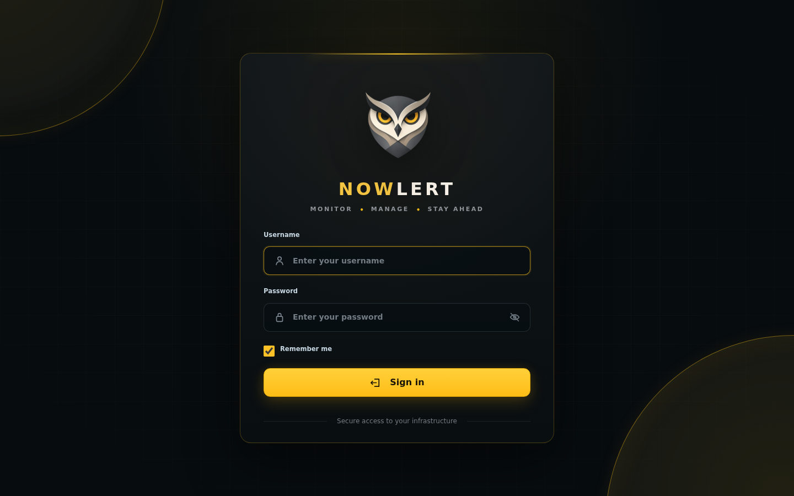

Use direct HTTP only on a trusted private network. Public or otherwise
untrusted deployments should terminate TLS at a trusted reverse proxy and set:

```yaml
platform:
  secure_cookies: true

webui:
  public_url: "https://nowlert.example.com"
  enforce_https: true
```

## Navigation

The sidebar offers **Dashboard**, **Routing Flow**, **Destinations**,
**Filtering**, **Email Alerts** (expanding to **Rules**, **Groups**,
**Mailboxes** and **Activity**), **Delivery history** and **Settings** to every
signed-in user. **Audit log**, **Backups** and **Users** are shown to
administrators only. The profile chip at the bottom of the sidebar opens the
profile menu with **Security** and **Sign out**. Administrators also see a
**Restart** control in the header that opens the **Restart Nowlert**
confirmation.

There is no separate Sources, Routes, Inputs, API access, Updates or Data tools
page: those functions live inside the pages described below.

### Dashboard

The Dashboard combines the operational state that is most useful during normal
administration:

- a **Live** refresh indicator and the time range selector in the page
  header;
- metric cards for **Integrations** (used by active routes),
  **Destinations** (enabled destinations), **Routes** (enabled routing rules),
  **Success Rate** and **Failures** for the selected range, the last two with
  a change against the previous window;
- **Delivery Performance**: the delivery chart for the selected range with the
  Delivered, Failed and Retry counts, the success rate and the total attempts;
- **Recent Activity**: the latest delivery events, with **View all** leading
  to Delivery history;
- **Top Integrations** and **Top Destinations**;
- **System Health** with the Nowlert health checks and a **Details** link;
  and
- a **Workspace Summary** (API tokens, active filters, shared destinations,
  audit issues) below the panels.

The Integration → Route → Destination topology is no longer drawn on the
Dashboard; it lives on the Routing Flow page.

The delivery chart plots cumulative delivery outcomes with a thin pulsing yellow
line and animated pulses at recorded events. The animation restarts when the
Dashboard is entered or refreshed; reduced-motion preferences disable it. The
chart shares its selected time range with the Dashboard controls and has no
manual replay button.

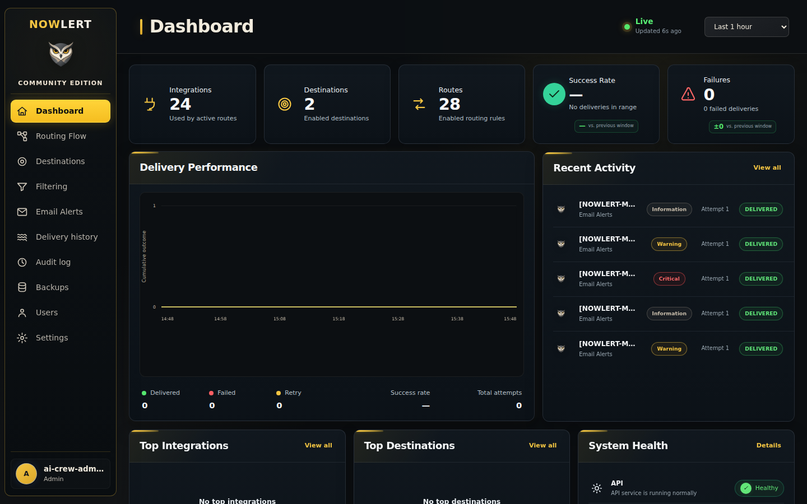

A regular account sees the same Dashboard with the shorter sidebar (no Audit
log, Backups or Users entries) and the **User** role label on the profile chip:

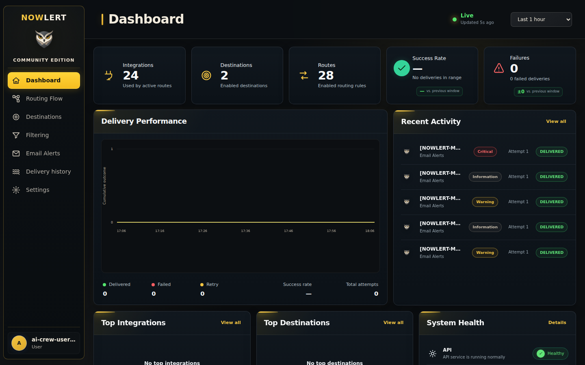

### Routing Flow

Routing Flow shows the active integration, filter, and destination topology
with live metrics. Its card highlight follows route type: direct paths pulse
yellow, filtered paths pulse grey, and endpoints shared by both use a split
yellow/grey pulse. Source receipts are counted independently of fan-out, so one
received event that reaches several destinations is still one source receipt.

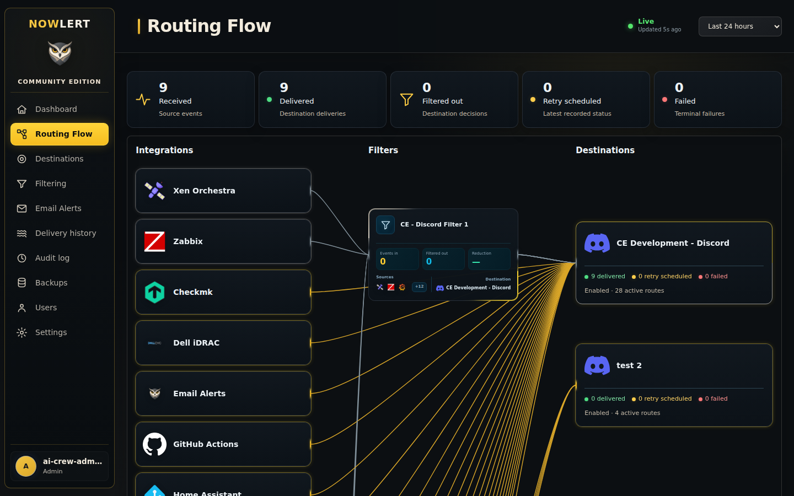

### Destinations

The Destinations page configures delivery targets for **Discord**,
**Microsoft Teams**, **Slack**, **Email**, **Nowlert Mobile** and **generic
webhooks**. MQTT and ntfy are no longer offered by the destination editor.

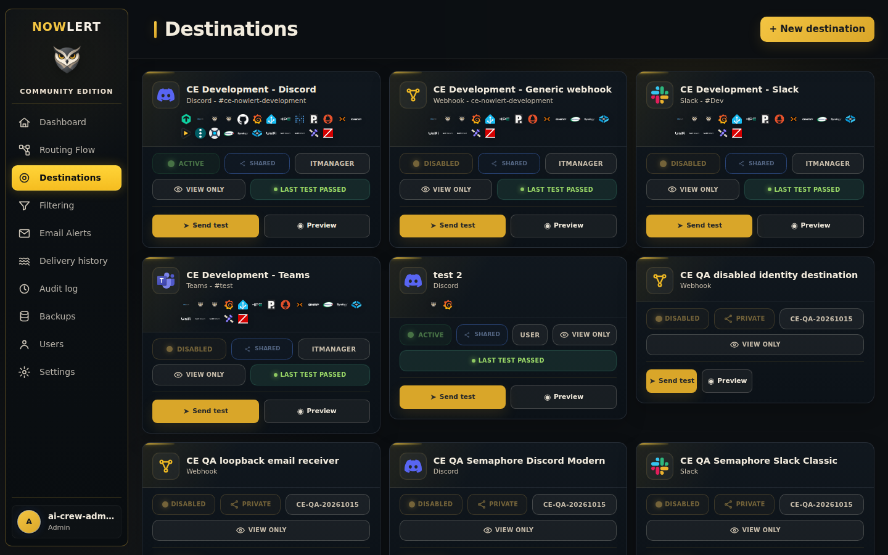

**+ New destination** opens the editor, titled **Add destination**, with the
destination name, type, enabled and shared switches, a **Connection and presentation** section and the
write-only credential fields for the chosen type:

- The display label is a text field whose name depends on the type:
  **Channel** for Discord and Slack, **Channel / workflow** for Microsoft
  Teams and **Destination label** for generic webhooks. Nowlert Mobile has no
  label field. Email has no label field either; it offers **SMTP server**,
  **Port**, **Security**, **Username**, **From**, **To**, **CC** and
  **Reply-To** (**To** is required, **CC** and **Reply-To** are optional).
- **Message style** selects **Modern Card** or **Classic Card** for Microsoft
  Teams, Slack, Nowlert Mobile and generic webhooks (Slack defaults to Classic
  Card, the others to Modern Card). Discord offers **Modern Card** or
  **Classic Embed** in the same **Message style** selector.
- **Webhook URL** is the write-only secret for Discord, Teams and Slack.
- **Nowlert Mobile** connects through **Connect Nowlert Mobile** and a
  temporary code approved in the mobile app; see
  [Nowlert Mobile](integrations/nowlert-mobile.md).

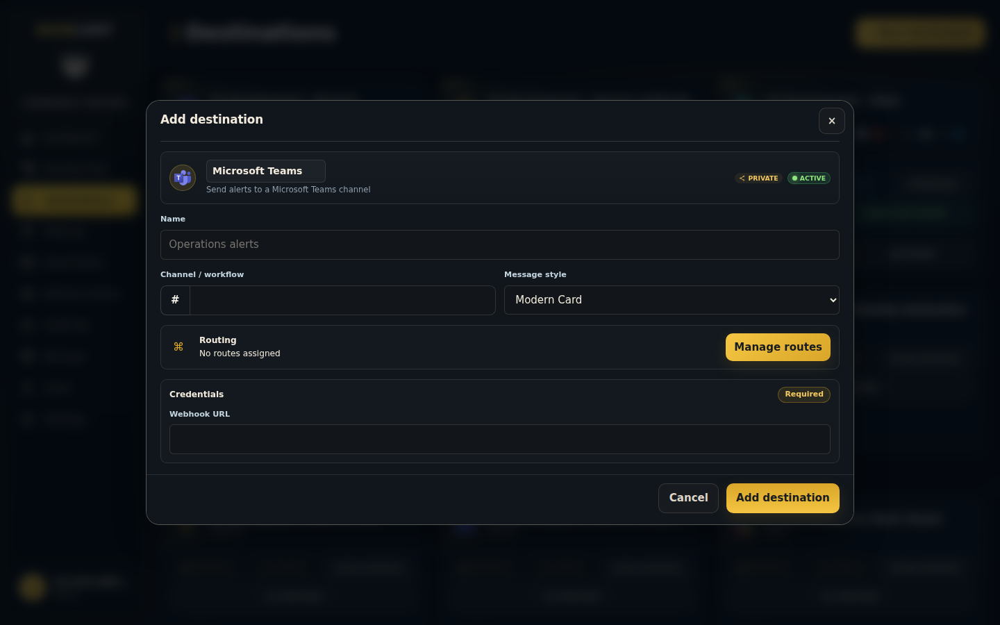

Destination owners can create, edit, preview, test, enable/disable,
share/private, and delete their own destinations. Sharing preserves the
creator's owner identity. Administrators can inspect, preview, and test another
user's destination, while its configuration remains view-only. The test action
sends a Nowlert-owned notification rendered in the destination's selected
message style.

**Preview** opens a dialog with the severity and message style selectors, the
route summary, an editable sample message and the generated payload for the
destination type. **Generate preview** renders the payload without sending
anything; **Send test delivery** is the separate action that delivers.
**Manage routes** in the dialog opens the same assigned routes drawer as the
editor: each route row shows its checkbox, integration icon, name and an
**Active** or **Disabled** badge in its own column, and the **Done** button at
the bottom of the drawer closes it. The **Message style** selector opens on
the style saved on the destination (for example **Modern Card** for a
Microsoft Teams destination saved as Modern Card), and the generated payload
follows that saved style. Preview builds one sample for every selected route
that supports the chosen severity, so with several routes the output lists
one entry per route.

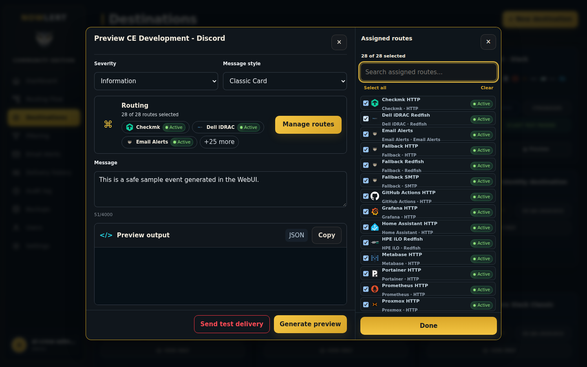

For a Discord destination the header line of the generated card names the
event state. When the event carries no state of its own, the header repeats
the selected severity instead of a generic **Information** label, so a
**Debug** or **Notice** preview reads Debug or Notice both in the header and
in the **Severity** metric; Information and its synonyms still read
Information, and Resolved, Critical and Warning events keep those words.

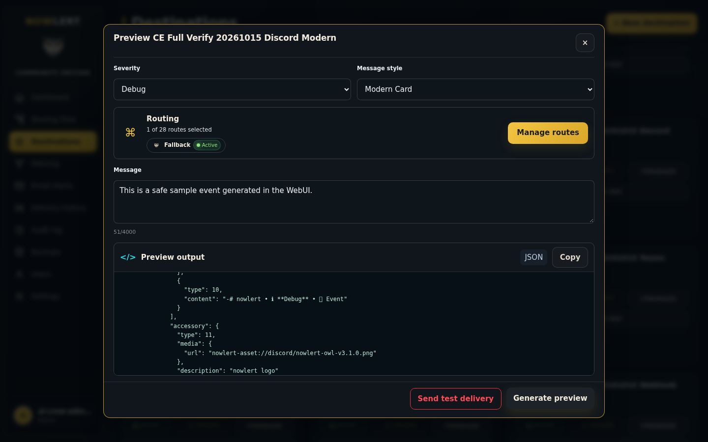

Two Microsoft Teams destinations, one saved as Modern Card and one
saved as Classic Card, with the preview output scrolled to the start of the
Adaptive Card body: the Modern Card body is a single rendered **Image**, the
Classic Card body starts with a **ColumnSet** of text:

| Modern Card | Classic Card |
|---|---|
| 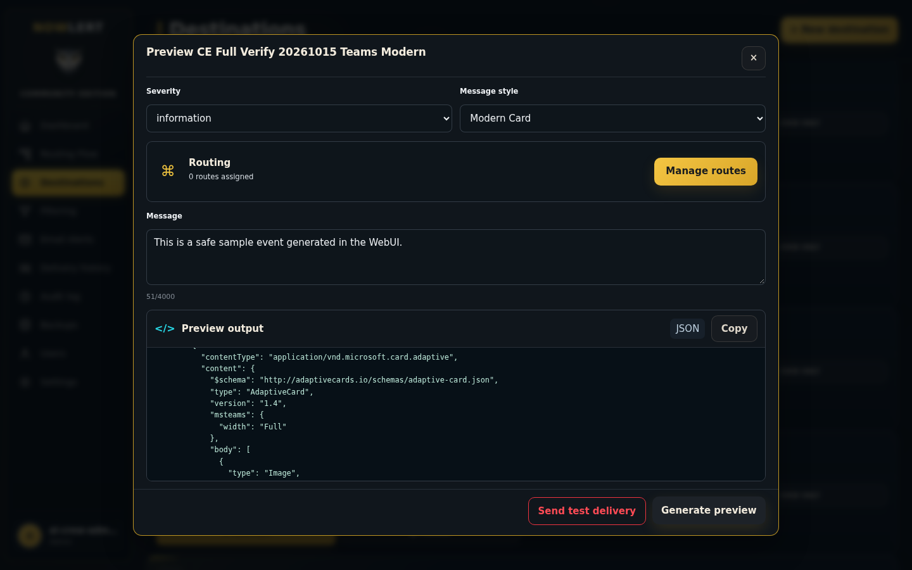 | 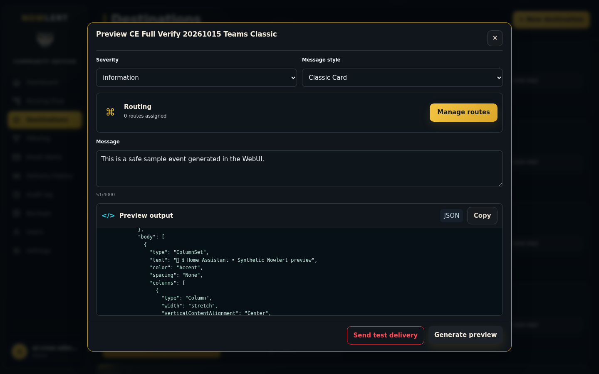 |

A regular account sees the destinations shared with it. Every destination in
this capture belongs to another owner and stays **View only**; the signed-in
account owns none of them:

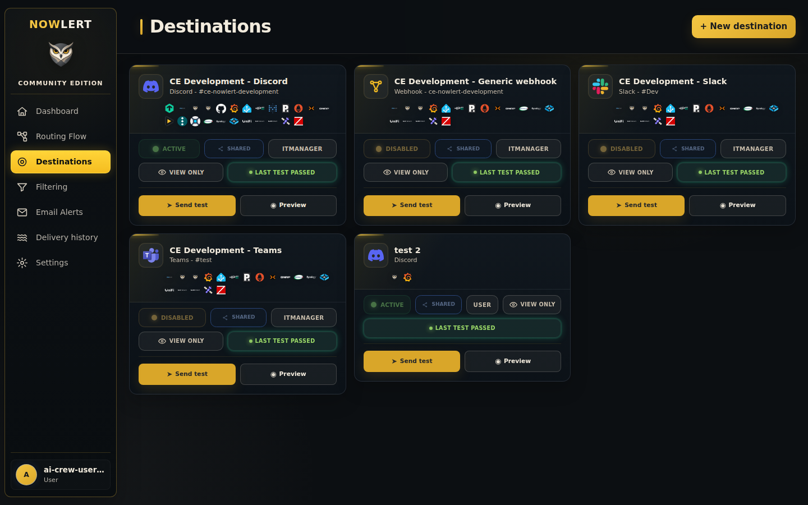

Credentials are write-only. The WebUI can indicate that a credential exists,
but normal read APIs do not return the stored webhook URL, password, token, or
secret-file path. A positive test state means a real destination test passed;
saving a credential alone is not presented as validation.

### Route assignments

In **Destinations**, create or edit a destination and select **Manage routes**.
Choose the built-in integration/input routes, select **Done**, then save the
destination. Done updates the form; **Save changes** (or **Add destination**)
persists the assignments. There is no separate Sources or Routes page.

Built-in integrations are packaged application capabilities. Routes are named
after the integration and its input, for example **Xen Orchestra SMTP** or
**Zabbix HTTP**. The normalized input badges are **SMTP**, **HTTP**,
**Redfish**, and **Email Alerts**. Dedicated matching routes are evaluated
before wildcard **Fallback** routes.

### Filtering

Open **Filtering** to configure destination-specific integration filters for
severity, status and supported application fields. Choose the destination to
filter; only integrations currently enabled for it are offered. Keep source
notifications broad, then suppress unwanted events centrally.

Administrative deterministic processing settings appear under **Integration
behavior** below the filter table on this page: Xen Orchestra job/run ID
visibility, Zabbix problem ID visibility, Dell iDRAC trusted management
clients, UniFi Protect device aliases, Home Assistant endpoint/component
aliases, Checkmk and other formatter filters, and Redfish deduplication.

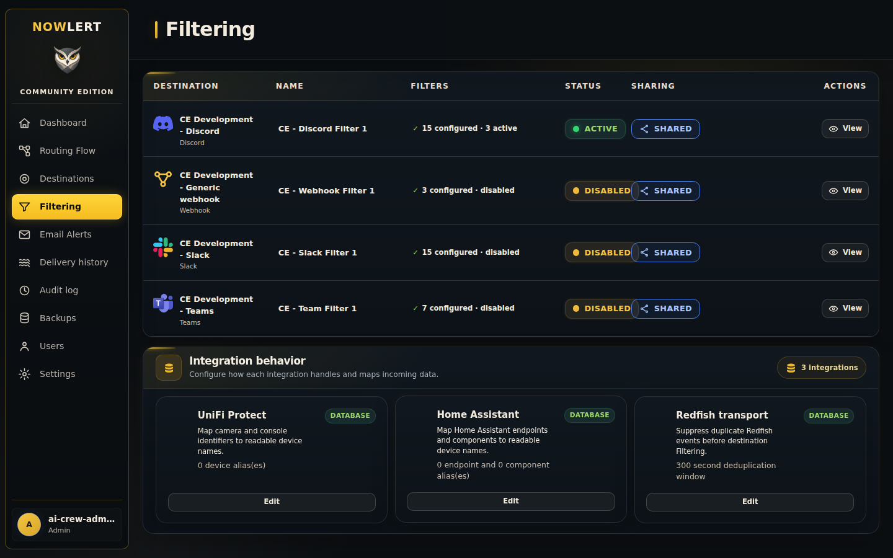

### Email Alerts

Email Alerts ingests messages from connected mailboxes instead of the SMTP
listener. The page has four tabs:

- **Mailboxes**: connect Gmail or Microsoft 365 mailboxes by signing in with
  the provider, or an IMAP / IMAPS mailbox with its host, port, security,
  username and password; the installation administrator configures the OAuth
  application once through deployment secrets. A mailbox can be private to its
  owner or shared.
- **Rules**: deterministic conditions on message metadata that classify
  matching mail.
- **Groups**: organise related classification rules and optionally suppress
  repeats for a quiet window.
- **Activity**: what was fetched, matched, deduplicated and routed.

| Rules | Groups |
|---|---|
| 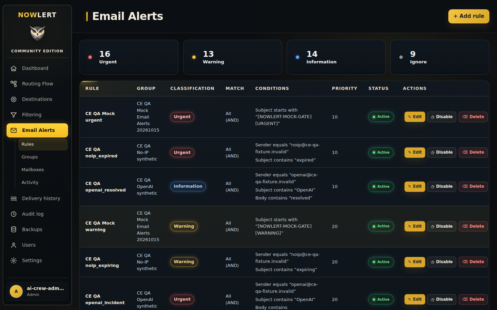 | 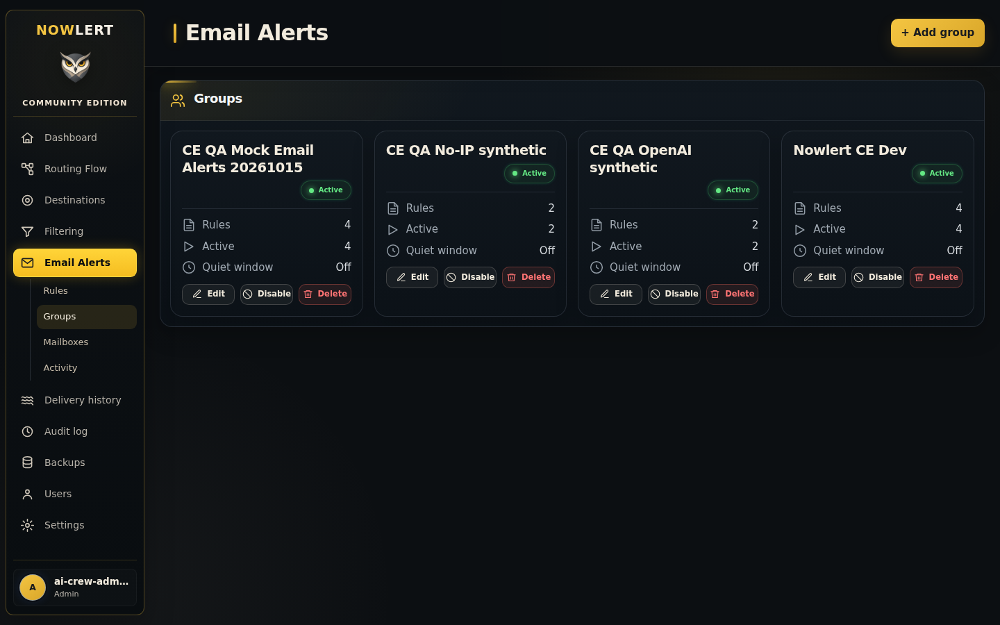 |

The Mailboxes and Activity tabs show the connected mailbox identity and fetched
message subjects, so they are described here in writing instead of captured.

**Edit** on an IMAP mailbox opens the same form as the connection with the
stored name, address, visibility, host, port and security filled in. A change
to the name or the visibility saves at once, without a folder scan. The
username and password fields are optional on edit: left blank, the stored
values are kept. A changed host, port, security, username, password or folder
is still verified against the server before it is saved, so a mailbox whose
server is unreachable can be renamed or shared but not repointed.

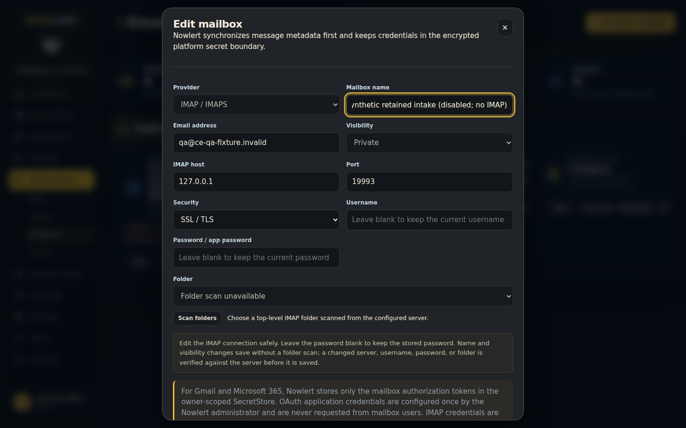

Matching messages are routed through the Email Alerts route like any other
event and appear in Delivery history. See the
[Gmail](guides/gmail-email-alerts.md),
[Microsoft 365](guides/microsoft-email-alerts.md) and
[shared rules](guides/gmail-microsoft-email-alerts.md) guides.

### Event API tokens

Open **Profile menu → Security → API tokens** to issue, rotate or revoke an Event API token. **New token** opens the **Issue Event API token** dialog, whose **Issue token** button creates the token.

Event API tokens authorize external applications to submit
`POST /api/v2/events`. They are not required for SMTP, dedicated vendor webhook
endpoints, Redfish subscriptions, WebUI login, or destination delivery.

Token values are displayed only at creation or successful rotation. The list
shows safe metadata such as source scopes, rate limit, last use, and state.
Rotate or revoke a token instead of trying to retrieve its previous value.

### Delivery history

Delivery history shows normalized event identity, source/input, destination,
attempt, outcome, safe error state, and time without exposing response bodies or
credentials. Severity filtering is applied before paging, and the page opens at
the newest events after a restart.

Pagination behavior is shared with Audit log:

- **First / Previous / Next / Last** remain available;
- the editable page number is embedded in `Page [n] of N - X items`;
- pressing Enter in that field performs direct navigation;
- **Top** sits on the left side of the bottom control row;
- **Entries** sits on the right side of the same row;
- page size persists; and
- the header **Bottom** shortcut and page-change scroll behavior remain.

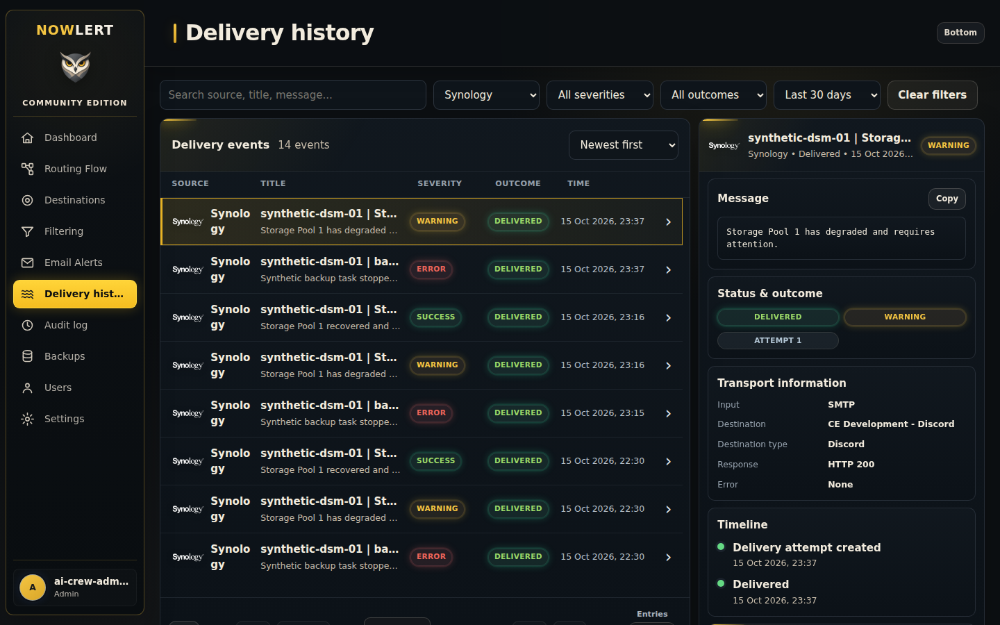

The capture shows the synthetic Synology sample events of the Development
deployment (device `synthetic-dsm-01`) with the **Last 30 days** range and the
first event selected, so the detail pane on the right shows its message,
outcome, transport information and timeline.

The historical v3.1.0 Delivery History capture was withdrawn on 22 October
2026 because a history row still showed a device-name prefix, and the
Zabbix-filtered Development capture of 21 October 2026 was withdrawn on
23 October 2026 because its sample rows carried VM-numbered host and database
labels (see the [screenshot privacy review](guides/screenshot-privacy.md));
the Development capture above is the packaged reference for this page.

### Audit log

Audit log records protected mutations using bounded, secret-free detail. Users
see activity allowed by the ownership model; administrators can inspect all
retained audit events. Filters, date range and sort are applied on the server
before paging, and it uses the same pagination contract as Delivery history.

The page shows the health checks, the filterable event list and the details
of the selected event. It is described here in writing instead of captured:
its rows name the signed-in accounts and carry internal record identifiers, and
the capture taken on 21 October 2026 was withdrawn on 23 October 2026 (see the
[screenshot privacy review](guides/screenshot-privacy.md)).

### Users

Administrators can:

- create regular or administrator accounts;
- enable/disable accounts;
- reset another user's password; and
- permanently delete an eligible user after explicit confirmation.

The list and the account counts update as soon as a create, enable, disable
or delete request succeeds; the background reload that follows only reconciles
them.

Deletion is protected by server-side account/ownership safety checks and is
audited. The last enabled administrator cannot be removed through a path that
would leave the platform without administrative access.

The sidebar profile chip uses the same authoritative account role as access
control, so administrator accounts display **Admin** and regular accounts
display **User**.

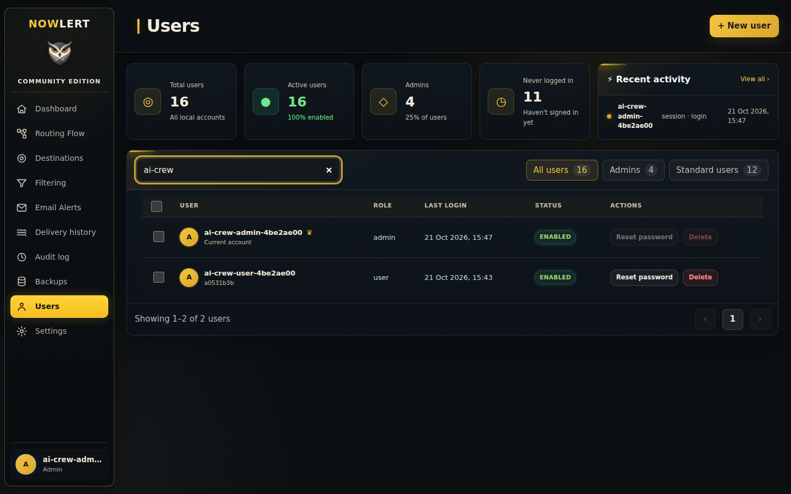

### Settings

Settings includes:

- **Regional settings**: language (twenty interface languages, English and
  Português among them), IANA timezone, and 12/24-hour clock; the timezone
  also controls timestamps generated by notification formatters;
- **Housekeeping**: scheduled-only retention with Enabled/Disabled state and
  recommended retention choices for Delivery history, Audit log, and
  backup-run records; and
- **Check for updates** for administrators.

Integration behavior controls live under **Filtering**.

Each settings record has an independent error boundary. One invalid record does
not make unrelated settings or pages unavailable.

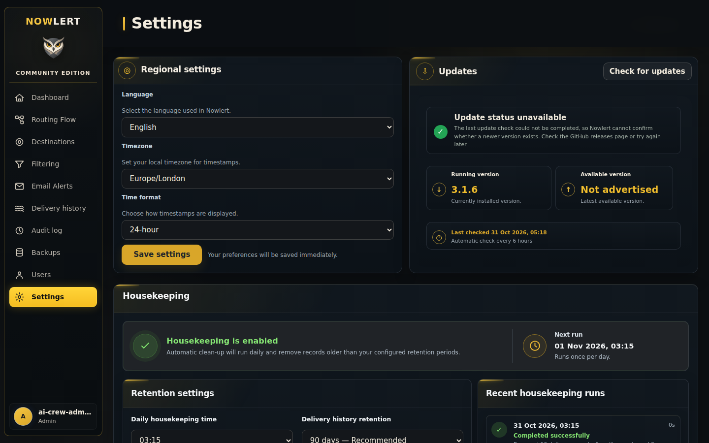

### Security

**Security** in the profile menu opens the **Security** page for the signed-in
account:

- account details and profile picture;
- **Change password**;
- **Multi-factor authentication**: **Enable MFA** with an authenticator app,
  one-time recovery codes to store safely (**I saved these codes**), and
  **Disable MFA** after confirming the current password and an authenticator
  code; and
- **API tokens**, as described under Event API tokens above.

| Administrator | Regular user |
|---|---|
| 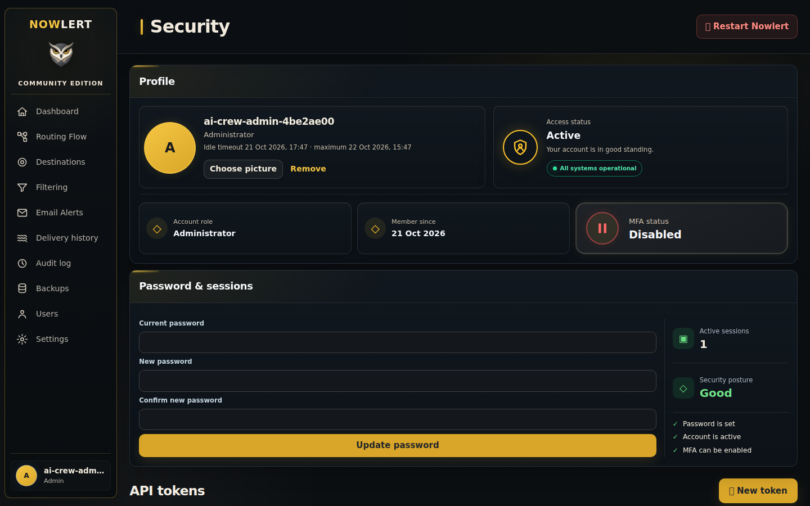 | 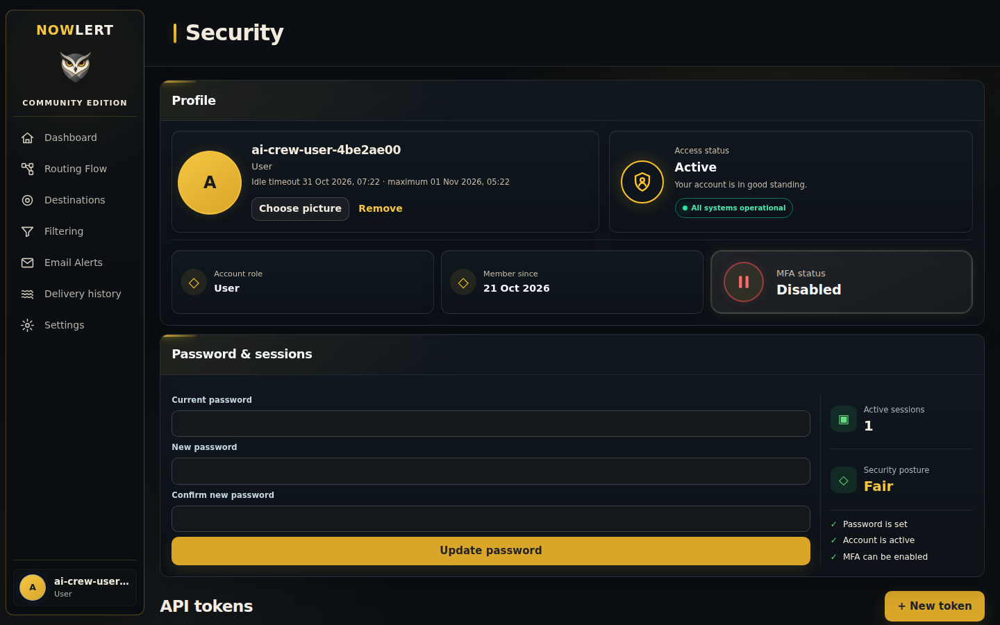 |

### Backups and Data tools

The Backups administration dashboard provides summary health, configured destinations, scheduled backup settings, portable Data Tools, local Recovery snapshots, and Stored copies discovered on Local/NFS/SMB targets.

The administration UI provides:

- complete recovery snapshots containing SQLite state/history, managed secrets,
  and mounted bootstrap configuration when available;
- individual local snapshot deletion after confirmation;
- Local/NFS/SMB backup destinations and discovery of snapshots stored there
  without scanning archive contents;
- scheduled daily, weekly, or monthly backup execution;
- manual backup runs;
- restore from either local or Local/NFS/SMB storage using local staging,
  integrity verification, a pre-restore safety snapshot and an automatic
  service restart; and
- credential-free Data Tools export/import for user-created configuration only.

Data Tools deliberately excludes users, credentials, token material, Delivery
history and Audit log. Housekeeping controls local history retention separately.

The Backups page shows the configured backup target addresses, so it is not
captured; follow the written steps above.

## Narrow browser windows

Nowlert CE is a desktop web application: the sections above describe it at
desktop width, and the 1440 px captures are the reference views. The same
WebUI also adapts to a narrow browser window, for example a tablet or a phone
browser. The captures in this section are secondary compatibility examples of
that responsive layout. They are not the Nowlert Mobile app, which is a
separate product that Nowlert CE delivers notifications to (see
[Nowlert Mobile](integrations/nowlert-mobile.md)).


The stylesheets switch layout at fixed widths. At 780 px and narrower the
sidebar leaves the page and slides in from the left over the content when the
menu button (☰) in the page header is pressed; above that width it stays a
column on the left, and the owl mark at its top collapses it to icons. The
Dashboard metric cards sit in five columns above 1180 px, in three columns at
1180 px and narrower and in one column at 840 px and narrower. Destination
cards fill one full-width column at 1100 px and narrower. Both captured widths
below therefore show the sidebar behind the menu button, the Dashboard with one
metric card per row and full-width destination cards. The Routing Flow metric
cards use their own grid: the captures show them in three columns at 768 px
and in two columns at 390 px. At 900 px and narrower the Email Alerts rules
table becomes a list of stacked rule cards (rule name and status first, then
classification and group, match and priority, the conditions, and the three
actions in a row) instead of a sideways-scrolling table. The same pages,
captured with an administrator account at 768 px and 390 px:

| Page | 768 px | 390 px |
|---|---|---|
| Dashboard | 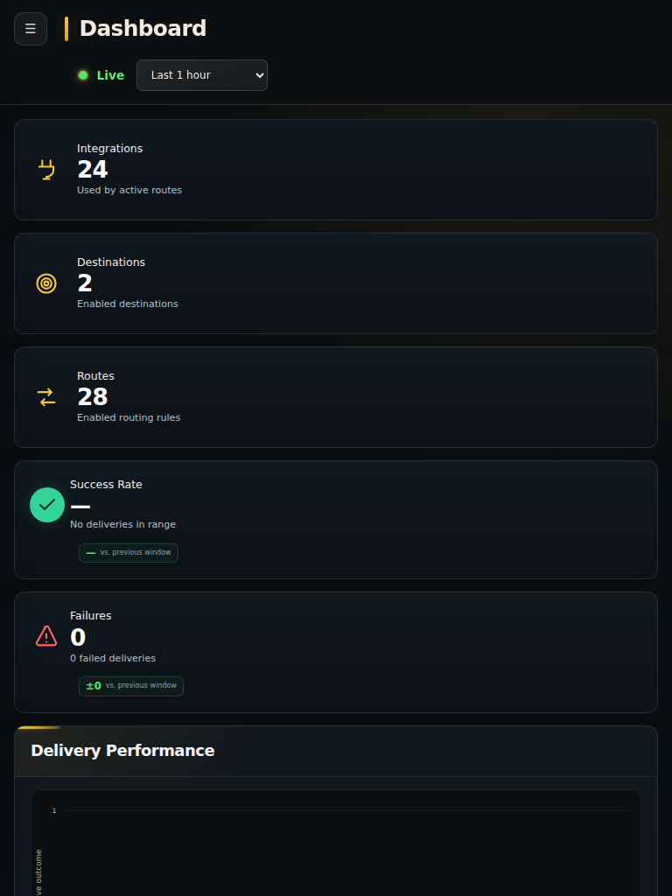 | 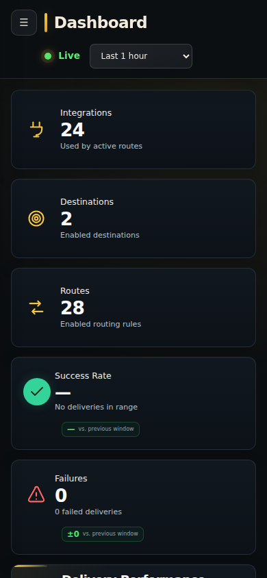 |
| Routing Flow | 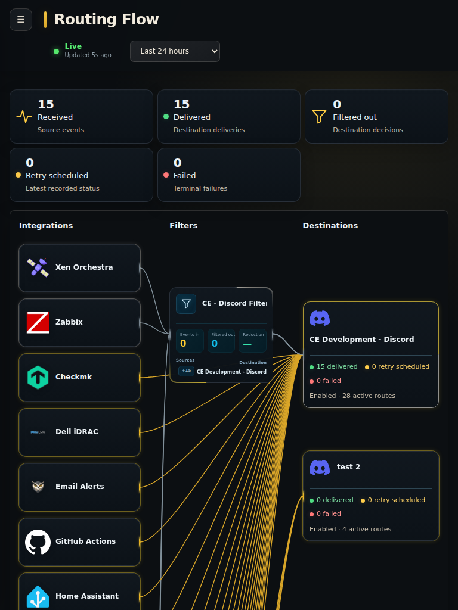 | 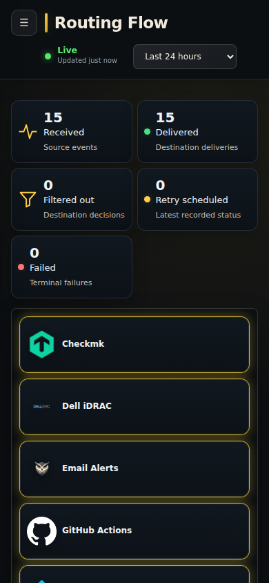 |
| Destinations | 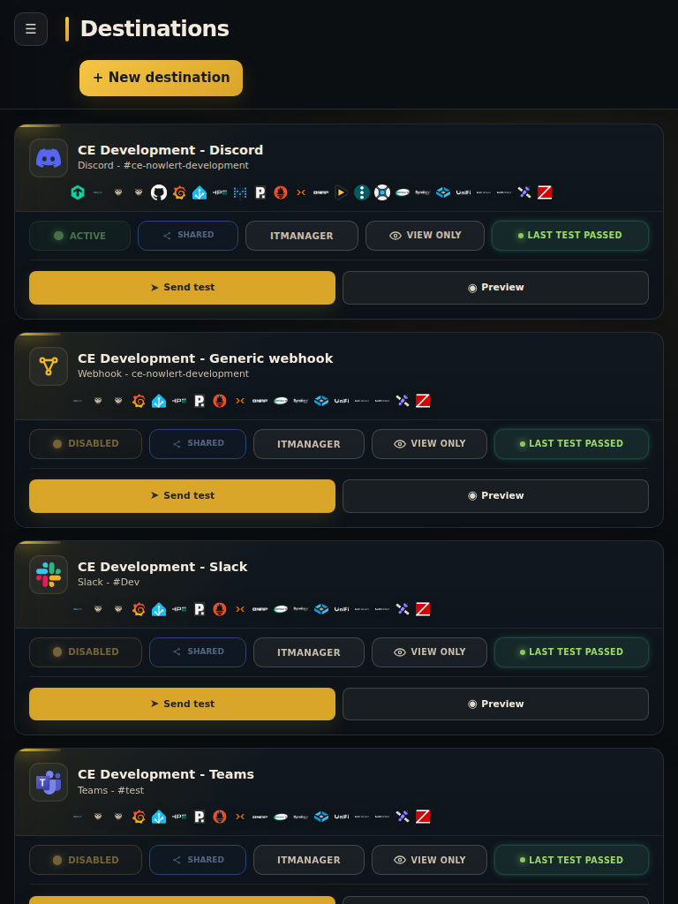 | 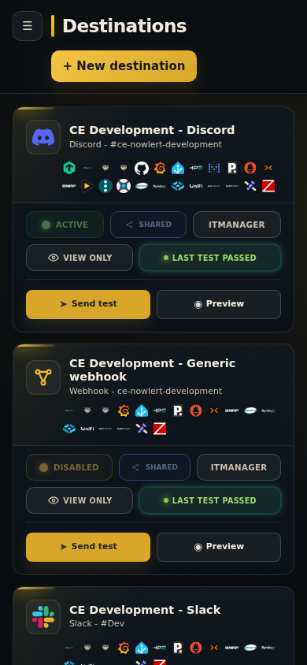 |
| Email Alerts rules | 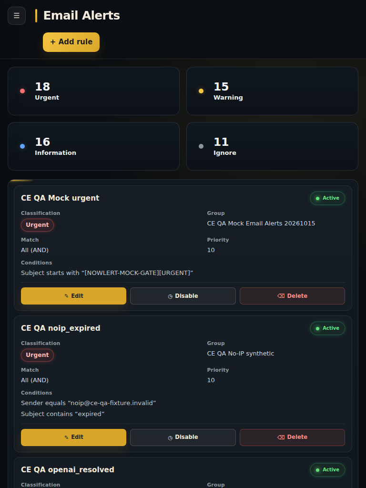 | 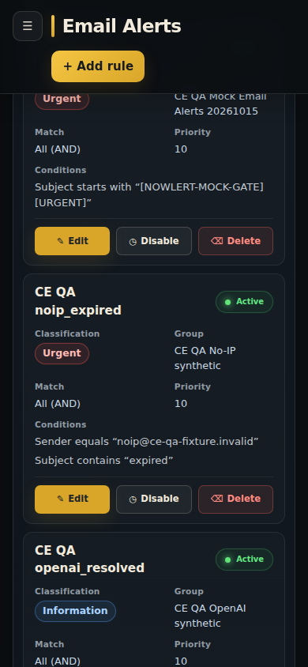 |

## Browser security

The WebUI relies on server-enforced security boundaries:

- HttpOnly, SameSite session cookies;
- optional Secure cookie mode;
- CSRF protection for unsafe session requests;
- restrictive content-security and frame policies;
- no credential, CSRF, token, or API-response persistence in localStorage;
- active-user keepalive for the 2-hour idle timeout without background-tab
  polling keeping an unattended session alive;
- a five-minute session-expiry warning and in-place re-authentication that keeps
  the current page and form state available while credentials are revalidated;
- timeout re-authentication preserves user-scoped sessionStorage display
  snapshots for warm first paint, while explicit Sign out purges those caches;
- optional multi-factor authentication with one-time recovery codes;
- write-only destination secrets; and
- one-time Event API token display.

## Persistent configuration model

SMTP, HTTP and Redfish listeners are configured through bootstrap settings.
Binding, TLS, authentication and process-level enablement changes require a
Nowlert restart. Email Alerts is not a listener: its mailboxes are connected in
the WebUI (see [Email Alerts](#email-alerts)). There is no separate Inputs
navigation page.

WebUI-managed resources are database-authoritative under `/nowlert/state`.
`config.yaml` is limited to process/bootstrap concerns such as listeners,
transport security, state location, and WebUI publication. See
[current-configuration-model.md](current-configuration-model.md).

## Current persistent schema

Current development uses database schema **18** and
`platform_database_v1`. Take a verified recovery snapshot before an upgrade
and keep an off-host copy until acceptance passes.
